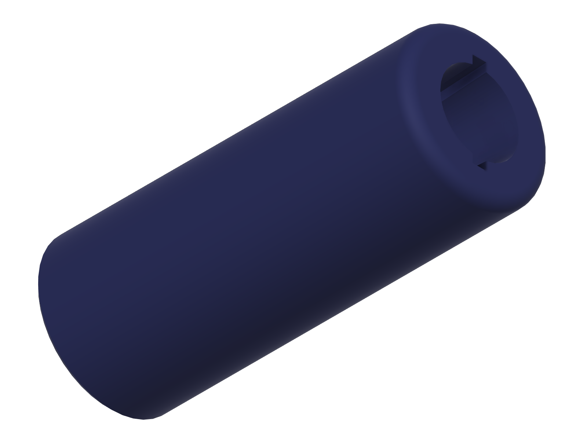
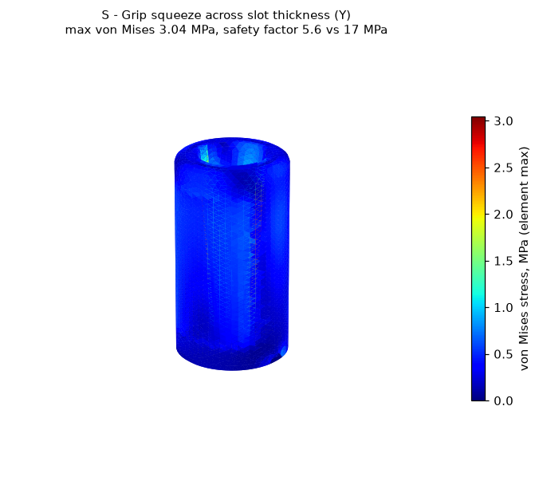

# Built-up handle sleeve

> **untested, v0.1** - This design has not been printed or physically tested.
> It is **not a medical device**. See the
> [repository disclaimer](../../DISCLAIMER.md).

Slides over a utensil or toothbrush handle to make it thicker, so it can be held with less grip force.

## Who it is for

People with reduced grip strength or limited finger flexion, for example from arthritis, neuropathy, or post-stroke weakness, who can still bring a hand to the mouth but cannot close firmly around a thin handle.

## Status

| Stage | State |
|-------|-------|
| Dimensions researched and cited | done |
| CAD built from named parameters | done (Fusion, 9 user parameters, all sketches fully constrained) |
| Model checked (dimensions, interference, min wall) | done |
| Static stress study run | done (open-source solver, see [Simulation](#simulation)) |
| STL and STEP exported | done (S, M, L) |
| Sliced and print stats recorded | done |

## Fit

The tapered bore and the slot accept two kinds of handle:

- **Round handles** (toothbrushes, many children's and plastic utensils): the bore tapers from 20 mm at the top to 6.4 mm at the bottom, and the handle wedges where it meets the taper. These are the largest and smallest bores sold for closed-cell foam built-up handle tubing (13/16 in and 1/4 in; see sources).
- **Flat handles** (most metal cutlery): the 3.5 mm slot tapers from 24 mm wide at the top to 12 mm at the bottom. **The slot sizes are a design estimate.** I found no published dimensional standard for flatware handles. Measure your utensil and change `slot_t` / `slot_w_*` if needed.

## Size presets

Outer grip diameter follows Kong & Lowe (2005), where the most comfortable cylindrical handle diameter was **19.7 % of the user's hand length**. Hand length and breadth percentiles were computed directly from the public ANSUR II data (U.S. Army, 2012; 4,082 men, 1,986 women).

| Preset | Hand length used | Grip diameter (`grip_dia`) | Hand breadth used | Sleeve length (`grip_len`) |
|--------|------------------|----------------------------|-------------------|----------------------------|
| Small  | 165 mm (women, 5th percentile) | 32.5 mm | 72 mm (women, 5th) | 80 mm |
| Medium | 189.5 mm (all, median) | 37.5 mm | 86 mm (all, median) | 95 mm |
| Large  | 210 mm (men, 95th percentile) | 41.5 mm | 96 mm (men, 95th) | 105 mm |

Diameter = 0.197 x hand length, rounded to the nearest 0.5 mm. Length = hand breadth plus 8 to 9 mm of clearance, rounded to a multiple of 5 mm (that clearance is a design choice, not a published value).

## Print settings

Sliced with the **ElegooSlicer 1.5.2.2 command line** using its bundled Prusa MK3S profile (PrusaSlicer was not available). Times are the slicer's estimate, not a measured print.

| Setting | Value |
|---------|-------|
| Printer profile | Prusa MK3S, 0.4 mm nozzle |
| Material | PLA (Prusa Generic PLA profile, density 1.24 g/cm3) |
| Layer height | 0.30 mm (first layer 0.20 mm) |
| Perimeters | 2 (0.50 mm extrusion width) |
| Top / bottom layers | 4 / 3 |
| Infill | 10 %, crosshatch |
| Supports | none (the slicer generated no support material) |
| Orientation | upright, wide flat base on the bed, bore opening up |

| Preset | Print time | Filament | Slicer |
|--------|-----------|----------|--------|
| Small  | 1 h 07 m | 22.5 g | ElegooSlicer 1.5.2.2 CLI |
| Medium | 1 h 33 m | 31.5 g | ElegooSlicer 1.5.2.2 CLI |
| Large  | 1 h 54 m | 41.0 g | ElegooSlicer 1.5.2.2 CLI |

At 0.20 mm layers the Large preset takes 2 h 14 m, over the 2-hour target, so 0.30 mm is the documented setting.

## How to resize

Every dimension is a named user parameter. Open the `.f3d` in `cad/` (or run `cad/build_handle_sleeve.py` in Fusion), go to **Modify > Change Parameters**, and edit the parameter, not the geometry.

| Parameter | Default (M) | Controls |
|-----------|-------------|----------|
| `grip_dia` | 37.5 mm | Outer diameter you hold |
| `grip_len` | 95 mm | Sleeve length |
| `bore_top_dia` | 20 mm | Round bore diameter at the open end |
| `bore_bot_dia` | 6.4 mm | Round bore diameter at the base |
| `slot_w_top` | `min(24 mm; grip_dia - 2*(top_fillet + 3 mm))` | Flat-handle slot width at the open end, capped to keep at least 3 mm of wall under the fillet |
| `slot_w_bot` | 12 mm | Flat-handle slot width at the base |
| `slot_t` | 3.5 mm | Flat-handle slot thickness |
| `top_fillet` | 3 mm | Rounded rim at the open end |
| `base_chamfer` | 1 mm | 45 degree chamfer on the bed edge |

If you make the sleeve thinner or the bore larger, re-check the minimum wall (below).

## How to use

1. Pick the preset closest to your hand (or measure your hand length and set `grip_dia` to about 0.2 x that).
2. Print upright with the settings above. No supports.
3. Push the utensil or toothbrush handle into the open end. Round handles go into the bore, flat handles into the slot, and push until the handle wedges.
4. If it is loose, wrap the handle with tape or reduce `bore_bot_dia` / `slot_t` and reprint. If it will not go in, enlarge them.
5. Check before each use that the handle is still held tight. Wash by hand; PLA softens at about 55 C (heat deflection temperature in the Prusament PLA datasheet), so not in a dishwasher.

## Model checks (from the Fusion model)

| Check | Result |
|-------|--------|
| Timeline | 11 features, 0 errors |
| Sketches | 5 of 5 fully constrained |
| Bounding box (S / M / L) | 32.5 x 32.5 x 80 / 37.5 x 37.5 x 95 / 41.5 x 41.5 x 105 mm |
| Base | flat, on z = 0, 1 mm chamfer (45 degrees) |
| Overhangs | none: the bore and slot only narrow toward the base, so every inner wall leans outward going up |
| Interference | single body, no parts to interfere |
| Minimum wall (Fusion `measureMinimumDistance`) | S 2.85 mm, M 3.62 mm, L 5.62 mm, all at the top rim where the fillet meets the slot corner |

The first build had a 24 mm slot on every preset, which left about 1.25 mm of wall under the top fillet on the Small preset. `slot_w_top` is now capped by the grip diameter (see changelog).

## Simulation

**Solver note:** Fusion's simulation scripting API (`adsk.sim`, a preview feature) returned no simulation product on this install, so these studies were run with open-source tools instead: **gmsh 4.15.2** (tetrahedral mesh from the exported STEP) and **scikit-fem 12.0.2** (quadratic tetrahedra, linear static stress, AMG-preconditioned conjugate gradient, relative residual below 1e-9). **This is not a Fusion Simulation result.** Setup, solver and raw results are in `simulation/`.

| Item | Value |
|------|-------|
| Study type | linear static stress |
| Material | PLA: E = 2.3 GPa (Prusament PLA datasheet, printed horizontal), Poisson's ratio 0.36 (**assumed**, not in the datasheet) |
| Failure stress used | 17 MPa, the datasheet's interlayer adhesion, the weakest direction of a printed part. The 51 MPa in-plane yield is also reported in the results files. |
| Load case 1 | Grip squeeze across the slot width: 500 N from each side, on two opposing 90 degree patches of the outer surface, skipping 10 mm at each end |
| Load case 2 | Same squeeze, across the slot thickness |
| Load case 3 | Utensil lever: outer surface held fixed below the top 25 mm; 102 N sideways on the slot and bore walls in the top 25 mm |
| Constraints | Squeeze cases: the loads balance each other, so the part is held only by a 3-2-1 point support at the base; stresses within 4 mm of those three points are excluded as support artifacts (raw values kept in the results). Lever case: fixed outer surface as described. |
| Reasoning for loads | 500 N = 51 kg, the peak median grip strength of men (Dodds et al. 2014), the strongest squeeze a typical user is likely to apply. 102 N = 10.4 kg, the mean right-hand key pinch of healthy men (Gunther et al. 2008), used as a deliberately high estimate of the sideways force a hand can push through a held utensil. |
| Peak von Mises stress | S 3.04 MPa (2 mm mesh), M 1.75 MPa, L 1.27 MPa (3 mm mesh); all from the squeeze across slot thickness |
| **Minimum safety factor** | **5.6** (Small preset, 2 mm mesh, against 17 MPa). M 9.7, L 13.4 |
| Mesh check | Small preset worst case 2.70 MPa at 3 mm vs 3.04 MPa at 2 mm (+13 %) |

Target met: minimum safety factor at or above 2. No revision was needed.

## Known limits

- **Never printed, never handled, never tested by a person.**
- **The stress model is a solid part. The print settings above give 2 perimeters and 10 % infill**, so the real part is mostly hollow and will be less stiff and less strong than modelled. The safety factor of 5.6 is for the solid geometry. If you need more margin, print with more perimeters or more infill (this adds time and filament; re-slice to check).
- Material values are datasheet values for test bars, not measured on this part. Poisson's ratio is assumed.
- The flat-handle slot sizes are a design estimate, not from a published standard.
- The fit of the tapered bore and slot depends on your utensil. It is held by wedging only, with no clip or set screw.
- PLA softens near 55 C. Not for dishwashers, hot drinks left in contact, or a hot car.
- Load cases are estimates of strong use built from population strength data, not measurements of anyone using this device.

## Files

| File | Description |
|------|-------------|
| `cad/handle-sleeve_v0.1.f3d` | Fusion archive (parametric, M preset active) |
| `cad/build_handle_sleeve.py` | Fusion API script that rebuilds the model from scratch |
| `cad/model_measurements.json` | Volume, bounding box and parameters per preset, read from Fusion |
| `step/handle-sleeve_{S,M,L}.step` | STEP per size preset |
| `stl/handle-sleeve_{S,M,L}.stl` | STL per size preset (binary, high refinement) |
| `renders/` | Fusion viewport captures (iso, top) |
| `simulation/` | Solver (`fe_solver.py`), study setups (`study_*.json`), results (`*_results.json`), stress plots |

## Sources

- Kong, Y.-K. & Lowe, B. D. (2005). Optimal cylindrical handle diameter for grip force tasks. *International Journal of Industrial Ergonomics* 35(6), 495-507. Record: https://stacks.cdc.gov/view/cdc/197408
- ANSUR II public data (U.S. Army Natick, 2012), via Penn State OPEN Design Lab: https://www.openlab.psu.edu/ansur2/ (`handlength`, `handbreadth`; percentiles computed with linear interpolation)
- Dodds, R. M. et al. (2014). Grip strength across the life course: normative data from twelve British studies. *PLoS ONE* 9(12): e113637. https://doi.org/10.1371/journal.pone.0113637
- Gunther, C. M. et al. (2008). Key pinch in healthy adults: normative values. *Journal of Hand Surgery (European Volume)*. https://doi.org/10.1177/1753193408087031
- Prusament PLA technical datasheet v1.1 (2022-02-16), Prusa Polymers: https://prusament.com/wp-content/uploads/2022/10/PLA_Prusament_TDS_2021_10_EN.pdf
- Closed-cell foam built-up handle tubing bore sizes (1/4 in, 3/8 in, 13/16 in), e.g. Essential Aids: https://essentialaids.com/children-with-disabilities/children-s-cutlery/closed-cell-foam-tubing.html

## Version and changelog

| Version | Date | Change |
|---------|------|--------|
| v0.1 | 2026-11-10 | First build. Tapered round bore and flat-handle slot; S/M/L presets from ANSUR II. |
| v0.1 | 2026-11-10 | Check fix: `slot_w_top` capped at `grip_dia - 2*(top_fillet + 3 mm)`; Small-preset minimum wall raised from about 1.25 mm to 2.85 mm. Re-exported and re-sliced. |
| v0.1 | 2026-11-10 | Static stress study (gmsh + scikit-fem): minimum safety factor 5.6, no revision needed. |
