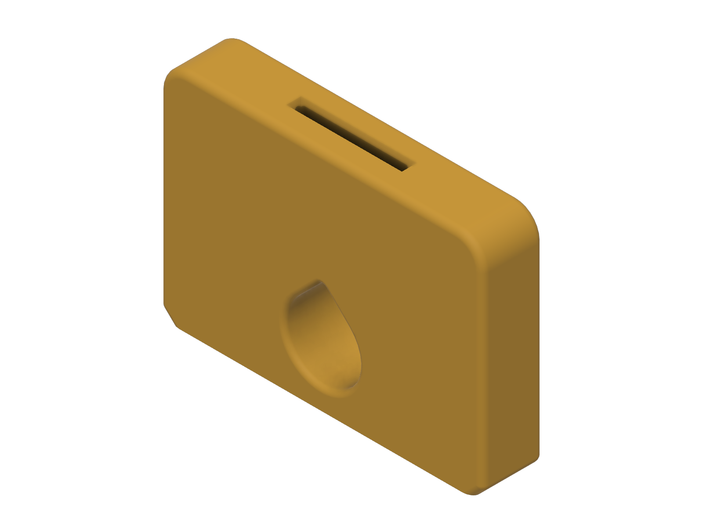
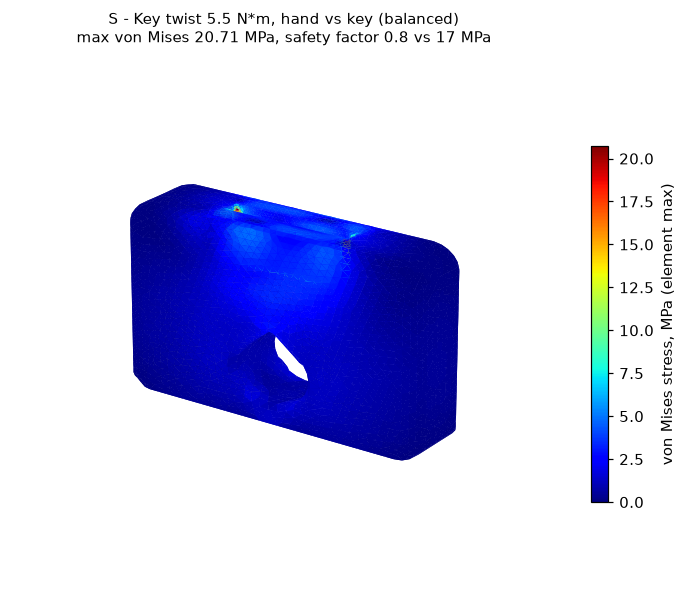

# Key turner

> **untested, v0.1** - This design has not been printed or physically tested.
> It is **not a medical device**. See the
> [repository disclaimer](../../DISCLAIMER.md).

A large paddle that holds a house key, so a key can be turned with a whole-hand grip instead of a fingertip pinch.

## Who it is for

People who find turning a key difficult because of weak pinch, painful finger joints, or limited fine finger control, for example with arthritis. The paddle gives a longer lever and a surface you can grip with the whole hand. A teardrop finger hole lets you hook a finger through instead of pinching.

## Status

| Stage | State |
|-------|-------|
| Dimensions researched and cited | done (key slot sizes are design estimates, see Fit) |
| CAD built from named parameters | done (Fusion, 15 user parameters, all sketches fully constrained) |
| Model checked (dimensions, interference, min wall) | done |
| Static stress study run | done, 3 design revisions (open-source solver, see [Simulation](#simulation)) |
| STL and STEP exported | done (S, M, L) |
| Sliced and print stats recorded | done |

## Fit

The key's bow (the flat head) pushes into a slot cut down from the top edge of the paddle. The blade sticks out of the top.

| Slot dimension | Value | Basis |
|----------------|-------|-------|
| Thickness `key_t` | 2.4 mm | 2.0 mm KW1 blade thickness from a single retailer listing, plus 0.4 mm clearance. **No manufacturer specification found. Measure your key.** |
| Width `key_slot_w` | 32 mm | design estimate for the bow of common house keys |
| Depth `key_slot_d` | 18 mm | design estimate (revised from 24 mm, see changelog) |

The key is held only by friction. If yours is loose, reduce `key_t` by 0.1 mm steps; if it will not go in, increase it.

## Size presets

The paddle length (the part your hand wraps around) uses the same rule as the built-up handle sleeve: ANSUR II hand breadth plus 8 to 9 mm, rounded to a multiple of 5 mm. Height and finger-hole size are design estimates chosen to keep at least 6 mm of material around the hole; ANSUR II has no finger-breadth measurement.

| Preset | Hand breadth used (ANSUR II) | `paddle_w` | `paddle_h` | `finger_d` |
|--------|------------------------------|------------|------------|------------|
| Small  | 72 mm (women, 5th percentile) | 80 mm  | 62 mm | 20 mm |
| Medium | 86 mm (all, median)          | 95 mm  | 66 mm | 22 mm |
| Large  | 96 mm (men, 95th percentile) | 105 mm | 70 mm | 24 mm |

Paddle thickness is 18 mm on every preset.

## Print settings

Sliced with the **ElegooSlicer 1.5.2.2 command line** using its bundled Prusa MK3S profile. Times are the slicer's estimate, not a measured print.

| Setting | Value |
|---------|-------|
| Printer profile | Prusa MK3S, 0.4 mm nozzle |
| Material | PLA (Prusa Generic PLA, 1.24 g/cm3) |
| Layer height | 0.30 mm (first layer 0.20 mm) |
| Perimeters | 2 (0.50 mm extrusion width) |
| Infill | 10 %, crosshatch |
| Supports | none (the slicer generated no support material) |
| Orientation | standing on its long bottom edge, key slot opening up |

| Preset | Print time | Filament | Slicer |
|--------|-----------|----------|--------|
| Small  | 1 h 22 m | 29.0 g | ElegooSlicer 1.5.2.2 CLI |
| Medium | 1 h 41 m | 35.8 g | ElegooSlicer 1.5.2.2 CLI |
| Large  | 1 h 54 m | 41.0 g | ElegooSlicer 1.5.2.2 CLI |

## How to resize

Open the `.f3d` in `cad/` (or run `cad/build_key_turner.py` in Fusion), then **Modify > Change Parameters**.

| Parameter | Default (M) | Controls |
|-----------|-------------|----------|
| `paddle_w` | 95 mm | Paddle length you grip |
| `paddle_h` | 66 mm | Paddle height |
| `paddle_t` | 18 mm | Paddle thickness (sets the key-slot wall thickness) |
| `key_t` | 2.4 mm | Key slot thickness |
| `key_slot_w` | 32 mm | Key slot width |
| `key_slot_d` | 18 mm | Key slot depth |
| `slot_leadin` | 1 mm | Chamfer at the slot opening |
| `slot_end_r` | `key_t / 2 - 0.1 mm` | Rounded slot ends |
| `slot_floor_r` | 1 mm | Rounded slot floor |
| `finger_d` | 22 mm | Finger hole diameter |
| `finger_z` | `finger_d / 2 + 6 mm` | Finger hole height |
| `top_r` | 8 mm | Top corner radius |
| `base_ch` | 3 mm | Bottom corner chamfer (45 degrees) |
| `edge_r`, `hole_r` | 2 mm, 1.5 mm | Comfort fillets |

## How to use

1. Measure your key's bow thickness. If it is not about 2 mm, change `key_t` before printing.
2. Print standing up with the settings above. No supports.
3. Push the key bow into the slot until it bottoms out. The blade should stick straight out of the top edge.
4. Put the key in the lock, hold the paddle with your whole hand (or hook a finger through the hole), and turn.
5. Check that the key is still tight in the slot before each use.

## Model checks (from the Fusion model)

| Check | Result |
|-------|--------|
| Timeline | 14 features, 0 errors |
| Sketches | 3 of 3 fully constrained |
| Bounding box (S / M / L) | 80 x 18 x 62 / 95 x 18 x 66 / 105 x 18 x 70 mm |
| Base | flat long edge on the bed; bottom corners chamfered at 45 degrees |
| Overhangs | none over 45 degrees: the finger hole is a teardrop with a 45 degree roof; the key slot has vertical walls |
| Interference | single body |
| Minimum wall (Fusion `measureMinimumDistance`) | 6.0 mm (finger hole to bed); key-slot side walls 7.8 mm; slot floor to finger hole at least 14.9 mm |

## Simulation

**Solver note:** Fusion's simulation scripting API returned no simulation product on this install, so the study was run with **gmsh 4.15.2 + scikit-fem 12.0.2** (quadratic tetrahedra, linear static). **This is not a Fusion Simulation result.** Inputs and results are in `simulation/`.

| Item | Value |
|------|-------|
| Study type | linear static stress |
| Material | PLA, E = 2.3 GPa (Prusament PLA datasheet), Poisson's ratio 0.36 (**assumed**) |
| Load | 5.5 N*m twist. The hand applies it as two opposite forces on the paddle faces (thumb on one face at one end, fingers on the other face at the other end, 72-95 N each depending on preset). The key resists it as two opposite forces on the key-slot walls (366 N each, uniform over each half wall). |
| Constraints | The two twists balance each other, so the part is held only by a 3-2-1 point support at the base; reactions came out at 0.0 N. Stresses within 4 mm of those support points are excluded. |
| Reasoning for the load | I found no published value for the torque needed to turn a key in a lock. 5.5 N*m is the top of the 2.9-5.5 N*m nominal jar-opening torque range (Steenbekkers, as cited in Yoxall & Rowson 2015), used as a **stand-in estimate** for a stiff household twisting task. |
| Failure criterion | The part prints standing up, so layers are horizontal. Tension across layers (sigma_zz) is compared with the 17 MPa interlayer adhesion. Von Mises stress is compared with the 51 MPa in-plane yield (both from the Prusament PLA datasheet). |
| Peak tension across layers | 7.44 MPa (S, 2.5 mm mesh, slot floor) |
| Peak von Mises | 20.7 MPa (S, 2.5 mm mesh, top of slot end) |
| **Minimum safety factor** | **2.21** (S preset, 3 mm mesh: 17 / 7.71 MPa across layers). S 2.5 mm mesh 2.28, M 2.22, L 2.38. |

Target met: minimum safety factor at or above 2, **but the margin is small**. Read the known limits.

**Under the stricter rule used for the handle sleeve (von Mises against 17 MPa), this design does not pass (0.82).** That rule treats every stress as if it pulled layers apart. The anisotropic rule above is the better match for an upright print, but it ignores interlayer shear, for which I have no datasheet value.

## Known limits

- **Never printed, never handled, never tested by a person.**
- **Thin safety margin (2.2).** The design load is a stand-in, not a measured key torque. A key that is very stiff in its lock can exceed it.
- The stress model is a solid part; the print is 2 perimeters and 10 % infill, so it is weaker than modelled. Print with more perimeters if in doubt.
- Interlayer shear is not checked (no datasheet value).
- Key slot sizes are not from a manufacturer specification; keys vary.
- The key is held by friction only. It can slip out of the slot if the fit is loose.
- PLA softens near 55 C.

## Files

| File | Description |
|------|-------------|
| `cad/key-turner_v0.1.f3d` | Fusion archive (parametric, M preset active) |
| `cad/build_key_turner.py` | Fusion API script that rebuilds the model |
| `cad/model_measurements.json` | Volume, bounding box and parameters per preset, read from Fusion |
| `step/`, `stl/` | Per-preset STEP and STL |
| `renders/` | Fusion viewport captures |
| `simulation/` | Solver, study setups, results, stress plot |

## Sources

- ANSUR II public data (U.S. Army, 2012), via Penn State OPEN Design Lab: https://www.openlab.psu.edu/ansur2/ (`handbreadth`)
- Yoxall, A. & Rowson, J. (2015). Talking about torque: measuring pack accessibility - a review. *Packaging Technology and Science* 28(1), 1-14. https://shura.shu.ac.uk/9128/ (cites Steenbekkers for the 2.9-5.5 N*m range)
- Prusament PLA technical datasheet v1.1: https://prusament.com/wp-content/uploads/2022/10/PLA_Prusament_TDS_2021_10_EN.pdf
- KW1 blade thickness 2.0 mm: single retailer listing (Digicom Jamaica, KW1 key blanks). Weak source; measure your key.

## Version and changelog

| Version | Date | Change |
|---------|------|--------|
| v0.1 | 2026-11-10 | First build: 14 mm paddle, 24 mm deep key slot, teardrop finger hole. |
| v0.1 | 2026-11-10 | Rev 1: rounded slot ends and slot floor after a sharp-corner stress peak grew with mesh refinement. |
| v0.1 | 2026-11-10 | Study setup corrected: the first runs fixed the slot walls rigidly, which put an artificial stress peak at the edge of the fixed area. Replaced with balanced hand and key loads. The corrected study gave SF 0.85 for v0.1 rev 1. |
| v0.1 | 2026-11-10 | Rev 2: slot depth 24 to 18 mm, paddle 14 to 16 mm. Anisotropic SF 2.08. |
| v0.1 | 2026-11-10 | Rev 3: paddle 16 to 18 mm. Anisotropic SF 2.21 (S, 3 mm mesh) to 2.28 (S, 2.5 mm mesh). Re-exported and re-sliced. |
