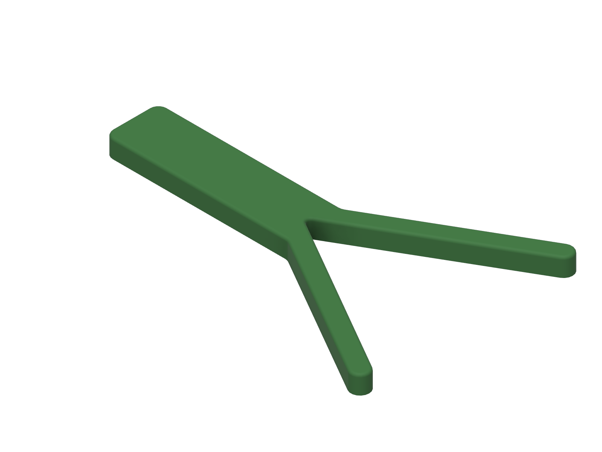

# Bottle and jar opener

> **untested, v0.1** - This design has not been printed or physically tested.
> It is **not a medical device**. See the
> [repository disclaimer](../../DISCLAIMER.md).

A flat "jar key": a V-shaped jaw wedges onto any cap from 28 mm bottle caps to 82 mm jar lids, and the handle gives you a long lever to twist it.

## Who it is for

People who cannot grip a cap or lid hard enough, or cannot twist the wrist strongly enough, to open bottles and jars. Wrist twisting strength falls with age: Yoxall & Rowson (2015) report a typical jar-opening torque of 2.9-5.5 N*m (citing Steenbekkers), and studies they review found that many older users cannot produce that much. The lever arm here is 100 mm or more, so the same torque needs far less force.

## Status

| Stage | State |
|-------|-------|
| Dimensions researched and cited | done |
| CAD built from named parameters | done (Fusion, 11 user parameters, sketch fully constrained) |
| Model checked (dimensions, interference, min wall) | done |
| Static stress study run | done (open-source solver, see [Simulation](#simulation)) |
| STL and STEP exported | done (S, M, L) |
| Sliced and print stats recorded | done |

## Fit

| Cap | Size | Source |
|-----|------|--------|
| Largest | 82 mm | Largest regular twist-off lug cap in a closure maker's size list (38, 43, 48, 53, 58, 63, 66, 70, 77, 82 mm) |
| Smallest | 28 mm | PCO 1881 bottle neck finish (28 mm lock ring). The cap's outside diameter is a little larger; I found no published figure. |

With a 30 degree half-angle, a cap of diameter D sits D millimetres from the point of the V. The jaw is 92 mm deep (82 mm plus 10 mm), so every cap from 28 to 82 mm has two contact lines on the jaw walls. The plate is 10 mm thick, so it grips the cap skirt over up to 10 mm of height.

## Size presets

The jaw is the same on every preset. Only the handle changes, using the same rule as the other devices: ANSUR II hand breadth plus 8 to 9 mm, rounded to 5 mm.

| Preset | Hand breadth used (ANSUR II) | `handle_len` | Overall size |
|--------|------------------------------|--------------|--------------|
| Small  | 72 mm (women, 5th percentile) | 80 mm  | 172 x 122 x 10 mm |
| Medium | 86 mm (all, median)          | 95 mm  | 187 x 122 x 10 mm |
| Large  | 96 mm (men, 95th percentile) | 105 mm | 197 x 122 x 10 mm |

All three fit the 250 x 210 mm bed of the Prusa MK3S profile used for slicing.

## Print settings

Sliced with the **ElegooSlicer 1.5.2.2 command line** using its bundled Prusa MK3S profile. Times are the slicer's estimate.

| Setting | Value |
|---------|-------|
| Printer profile | Prusa MK3S, 0.4 mm nozzle |
| Material | PLA (Prusa Generic PLA, 1.24 g/cm3) |
| Layer height | 0.30 mm (first layer 0.20 mm) |
| Perimeters | 2 (0.50 mm extrusion width) |
| Infill | 10 %, crosshatch |
| Supports | none (the slicer generated no support material) |
| Orientation | flat on the bed |

| Preset | Print time | Filament | Slicer |
|--------|-----------|----------|--------|
| Small  | 55 m     | 21.2 g | ElegooSlicer 1.5.2.2 CLI |
| Medium | 59 m     | 23.0 g | ElegooSlicer 1.5.2.2 CLI |
| Large  | 1 h 02 m | 24.2 g | ElegooSlicer 1.5.2.2 CLI |

## How to resize

Open the `.f3d` in `cad/` (or run `cad/build_jar_opener.py` in Fusion), then **Modify > Change Parameters**. Every outline point is dimensioned from these parameters.

| Parameter | Default (M) | Controls |
|-----------|-------------|----------|
| `cap_max` | 82 mm | Largest cap the jaw must seat (sets `jaw_len`) |
| `cap_min` | 28 mm | Smallest cap (documentation and study only) |
| `v_half` | 30 deg | Half-angle of the V |
| `jaw_len` | `cap_max / (2 * sin(v_half)) + 10 mm` | Depth of the V |
| `jaw_wall` | 10 mm | Jaw arm thickness |
| `handle_len` | 95 mm | Handle length |
| `handle_w` | 30 mm | Handle width |
| `plate_t` | 10 mm | Plate thickness |
| `apex_r`, `corner_r`, `top_r` | 2, 5, 1.5 mm | Radii and comfort fillet |

## How to use

1. Lay the opener on top of the lid, or hold it flat against the lid's side, and slide the V over the cap until both jaw walls touch it.
2. Hold the jar firmly (a non-slip mat helps) and push the handle anticlockwise. The cap wedges deeper into the V as you turn.
3. For small bottle caps, use the narrow end of the V near its point.

## Model checks (from the Fusion model)

| Check | Result |
|-------|--------|
| Timeline | 5 features, 0 errors |
| Sketches | 1 of 1 fully constrained |
| Base | the whole underside is flat on the bed |
| Overhangs | none: every side wall is vertical |
| Interference | single body |
| Minimum wall (Fusion `measureMinimumDistance`) | jaw arms 10.0 mm; plate 10.0 mm thick |

## Simulation

**Solver note:** Fusion's simulation scripting API returned no simulation product on this install, so the study was run with **gmsh 4.15.2 + scikit-fem 12.0.2** (quadratic tetrahedra, linear static; one run used a direct sparse solve when the iterative solver stalled). **This is not a Fusion Simulation result.**

| Item | Value |
|------|-------|
| Study type | linear static stress, 3 mm mesh |
| Material | PLA, E = 2.3 GPa (Prusament PLA datasheet), Poisson's ratio 0.36 (**assumed**) |
| Load | 5.5 N*m about the cap axis, applied as a sideways force on the outer 50 mm of the handle edge: 34-66 N depending on preset and cap size (force = torque / distance from cap centre to grip) |
| Constraints | The cap is modelled as two fixed patches on the jaw walls where it touches, 8 mm long and centred where the cap meets the wall: 61.5 mm along the handle axis from the point of the V for the 82 mm cap, and 21 mm for the 28 mm cap. |
| Reasoning for the load | 5.5 N*m is the top of the 2.9-5.5 N*m nominal jar-opening torque range (Steenbekkers, as cited in Yoxall & Rowson 2015) |
| Failure criterion | Printed flat, so loads act in the plane of the layers: von Mises against the 51 MPa in-plane yield, and tension across layers against the 17 MPa interlayer adhesion (Prusament PLA datasheet) |
| Peak von Mises / tension across layers | 7.99 / 4.82 MPa (L, 82 mm cap); 8.78 / 2.45 MPa (L, 28 mm cap) |
| **Minimum safety factor** | **3.53** (Large preset, 82 mm cap: 17 / 4.82 MPa). Small 4.58, Medium 3.80. |

Target met: minimum safety factor at or above 2. The peaks sit at the edges of the fixed cap patches, which a rigid fixed support exaggerates. Against the stricter rule (von Mises vs 17 MPa) the minimum is 1.94 (L, 28 mm cap); that rule is not the governing one for a flat print, but it is reported for comparison.

**No mesh-refinement check was completed for this device.** A 2 mm run did not converge with the iterative solver and was not repeated.

## Known limits

- **Never printed, never handled, never tested by a person.**
- The jaw is smooth PLA. It relies on the wedge of the V and friction, with no teeth. It may slip on smooth or greasy lids.
- The cap contact was modelled as a rigid fixed patch, not real contact with friction.
- The stress model is a solid part; the print is 2 perimeters and 10 % infill.
- The 28 mm lower limit is the bottle neck size, not the measured cap.
- No mesh-convergence check (see above).

## Files

| File | Description |
|------|-------------|
| `cad/jar-opener_v0.1.f3d` | Fusion archive (parametric, M preset active) |
| `cad/build_jar_opener.py` | Fusion API script that rebuilds the model |
| `cad/model_measurements.json` | Volume, bounding box and parameters per preset, read from Fusion |
| `step/`, `stl/` | Per-preset STEP and STL |
| `renders/` | Fusion viewport captures |
| `simulation/` | Solver, study setups, results |

## Sources

- Yoxall, A. & Rowson, J. (2015). Talking about torque: measuring pack accessibility - a review. *Packaging Technology and Science* 28(1), 1-14. https://shura.shu.ac.uk/9128/
- Lug cap size list (38-82 mm regular twist-off): ANT Packaging metal lug caps, https://www.antpackaging.com/metal-lug-cap.html
- PCO 1881 neck finish (28 mm): closure listings, e.g. Pelliconi 28 mm 1881, https://www.pelliconi.com/product/plastic-caps-28mm-1881/
- ANSUR II public data: https://www.openlab.psu.edu/ansur2/
- Prusament PLA technical datasheet v1.1: https://prusament.com/wp-content/uploads/2022/10/PLA_Prusament_TDS_2021_10_EN.pdf

## Version and changelog

| Version | Date | Change |
|---------|------|--------|
| v0.1 | 2026-11-10 | First build. V jaw for 28-82 mm caps, S/M/L handles. Static stress: minimum SF 3.53, no revision needed. |
