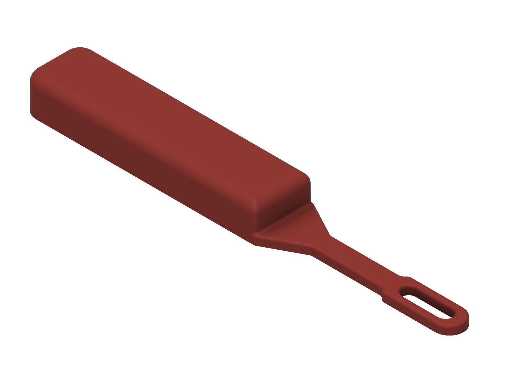

# Zipper and button pull

> **untested, v0.1** - This design has not been printed or physically tested.
> It is **not a medical device**. See the
> [repository disclaimer](../../DISCLAIMER.md).

A thick handle with a thin loop at the tip. The loop pulls buttons through buttonholes and catches zipper tabs, so you don't have to pinch them.

## Who it is for

People who find small buttons and zipper tabs hard to pinch or manipulate, for example with arthritis, reduced fingertip sensation, tremor, or one-handed dressing.

## Status

| Stage | State |
|-------|-------|
| Dimensions researched and cited | done (loop length and wire size are design estimates) |
| CAD built from named parameters | done (Fusion, 15 user parameters, all sketches fully constrained) |
| Model checked (dimensions, interference, min wall) | done |
| Static stress study run | done, 1 revision (open-source solver, see [Simulation](#simulation)) |
| STL and STEP exported | done (S, M, L) |
| Sliced and print stats recorded | done |

## Fit

- **Buttons:** the loop is 11.4 mm wide outside, which is 18 ligne (1 ligne = 1/40 in = 0.635 mm), a common shirt-button size. It is sized so it can pass through the buttonhole of an 18-ligne button. For bigger buttons, increase `loop_ow`; for smaller ones (16 ligne = 10.2 mm), reduce it.
- **Zippers:** the zipper's pull tab slides into the loop opening (5.4 mm wide, 20.5 mm long). **The opening size is a design estimate.** I found no published zipper-tab dimensions.
- The neck and loop are 3.5 mm thick, thin enough to go through a buttonhole.

## Size presets

Only the handle changes, using the library's rule: ANSUR II hand breadth plus 8 to 9 mm, rounded to 5 mm. The neck and loop are the same on every preset.

| Preset | Hand breadth used (ANSUR II) | `handle_len` | Overall size |
|--------|------------------------------|--------------|--------------|
| Small  | 72 mm (women, 5th percentile) | 80 mm  | 153 x 24 x 14 mm |
| Medium | 86 mm (all, median)          | 95 mm  | 168 x 24 x 14 mm |
| Large  | 96 mm (men, 95th percentile) | 105 mm | 178 x 24 x 14 mm |

## Print settings

Sliced with the **ElegooSlicer 1.5.2.2 command line** using its bundled Prusa MK3S profile. Times are the slicer's estimate.

| Setting | Value |
|---------|-------|
| Printer profile | Prusa MK3S, 0.4 mm nozzle |
| Material | PLA (Prusa Generic PLA, 1.24 g/cm3) |
| Layer height | 0.30 mm (first layer 0.20 mm) |
| Perimeters | 2 (0.50 mm extrusion width) |
| Infill | 10 %, crosshatch |
| Supports | none (the slicer generated no support material) |
| Orientation | flat on the bed |

| Preset | Print time | Filament | Slicer |
|--------|-----------|----------|--------|
| Small  | 32 m | 12.3 g | ElegooSlicer 1.5.2.2 CLI |
| Medium | 37 m | 14.2 g | ElegooSlicer 1.5.2.2 CLI |
| Large  | 40 m | 15.4 g | ElegooSlicer 1.5.2.2 CLI |

## How to resize

Open the `.f3d` in `cad/` (or run `cad/build_zipper_button_pull.py` in Fusion), then **Modify > Change Parameters**.

| Parameter | Default (M) | Controls |
|-----------|-------------|----------|
| `handle_len` | 95 mm | Handle length |
| `handle_w`, `handle_t` | 24 mm, 14 mm | Handle width and thickness |
| `taper_len`, `neck_len`, `neck_w` | 15, 30, 8 mm | Taper and neck between handle and loop |
| `hook_t` | 3.5 mm | Thickness of neck and loop |
| `loop_ow` | `18 * 0.635 mm` | Loop outer width (button size in ligne x 0.635 mm) |
| `loop_len` | 28 mm | Loop outer length |
| `wire_w` | 3 mm | Loop side wire width |
| `tip_w` | 4.5 mm | Loop tip depth (revised from 3 mm, see changelog) |
| `butt_r`, `trans_r`, `grip_r`, `hook_r` | 6, 2, 4, 1 mm | Radii and comfort fillets |

## How to use

**Buttoning:** hold the garment open, push the loop through the buttonhole from the outside, hook the loop around the button, and pull it back through the hole.

**Zipping:** slip the zipper's pull tab into the loop, then pull along the line of the zipper.

**Pull straight along the tool.** Do not lever the loop up or down: the thin neck is weak in that direction (see Known limits).

## Model checks (from the Fusion model)

| Check | Result |
|-------|--------|
| Timeline | 12 features, 0 errors |
| Sketches | 3 of 3 fully constrained |
| Base | the whole underside is flat on the bed |
| Overhangs | none: every side wall is vertical; the handle is a raised block on the plate |
| Interference | single body |
| Minimum wall (Fusion `measureMinimumDistance`) | 3.0 mm (loop side wires, 6 extrusion lines); neck 8.0 mm wide; neck and loop 3.5 mm thick |

## Simulation

**Solver note:** Fusion's simulation scripting API returned no simulation product on this install, so the study was run with **gmsh 4.15.2 + scikit-fem 12.0.2** (quadratic tetrahedra, linear static, 3 mm mesh with 1 mm elements around the neck and loop; direct sparse solve). **This is not a Fusion Simulation result.**

| Item | Value |
|------|-------|
| Material | PLA, E = 2.3 GPa (Prusament PLA datasheet), Poisson's ratio 0.36 (**assumed**) |
| Load case 1 (design) | 102 N axial pull on the inside of the loop tip (where a caught button or tab pulls), handle top face held fixed |
| Load case 2 (capacity) | 10 N up/down on the loop tip, same support, to find how much out-of-plane force the neck can take |
| Reasoning for the load | 102 N = 10.4 kg, the mean right-hand key pinch of healthy men (Gunther et al. 2008): a deliberately high estimate of the force a user can pull with |
| Failure criterion | Printed flat: von Mises against the 51 MPa in-plane yield, tension across layers against the 17 MPa interlayer adhesion (Prusament PLA datasheet) |
| Axial pull, peak von Mises | 21.1 MPa (S), 20.4 MPa (M), 20.0 MPa (L), at the inner end of the loop opening |
| **Minimum safety factor (design load)** | **2.42** (S, axial pull). M 2.50, L 2.55. |
| Out-of-plane capacity | 10 N gave SF 1.19-1.23 across presets (S: 41.6 MPa von Mises at the neck root, 11.9 MPa across layers at the handle step). Scaling linearly, **SF 2 is reached at about 6 N and failure (SF 1) at about 12 N** out of plane. |

Target met for the design load (straight pull). Against the stricter rule (von Mises vs 17 MPa) the axial case is 0.81. That rule does not govern a flat print, but it is reported for comparison.

## Known limits

- **Never printed, never handled, never tested by a person.**
- **The neck is weak out of plane: about 6 N up or down at the loop tip reaches SF 2.** Pull straight along the tool. A thicker neck that steps down to the 3.5 mm loop is the planned v0.2 fix.
- Out-of-plane capacity was found by scaling one linear run, not by a separate study at that load.
- Loop length, wire width and opening size are design estimates.
- The stress model is a solid part; the print is 2 perimeters and 10 % infill.
- PLA can snap rather than bend. Inspect the loop before each use.

## Files

| File | Description |
|------|-------------|
| `cad/zipper-button-pull_v0.1.f3d` | Fusion archive (parametric, M preset active) |
| `cad/build_zipper_button_pull.py` | Fusion API script that rebuilds the model |
| `cad/model_measurements.json` | Volume, bounding box and parameters per preset, read from Fusion |
| `step/`, `stl/` | Per-preset STEP and STL |
| `renders/` | Fusion viewport captures |
| `simulation/` | Solver, study setup, results, stress plots |

## Sources

- Ligne (button size unit, 1/40 in = 0.635 mm): https://en.wikipedia.org/wiki/Ligne ; button size charts, e.g. https://www.purlsoho.com/create/button-conversion-chart/
- ANSUR II public data: https://www.openlab.psu.edu/ansur2/
- Gunther, C. M. et al. (2008). Key pinch in healthy adults: normative values. *Journal of Hand Surgery (European Volume)*. https://doi.org/10.1177/1753193408087031
- Prusament PLA technical datasheet v1.1: https://prusament.com/wp-content/uploads/2022/10/PLA_Prusament_TDS_2021_10_EN.pdf

## Version and changelog

| Version | Date | Change |
|---------|------|--------|
| v0.1 | 2026-11-10 | First build: 3 mm loop wire all round. Static stress, axial pull: SF 1.95, under target. |
| v0.1 | 2026-11-10 | Rev 1: loop tip deepened to 4.5 mm (`tip_w`), side wires unchanged so the loop still fits an 18-ligne buttonhole. Axial pull SF 2.42 (S) / 2.50 (M). Out-of-plane capacity recorded as a known limit. |
