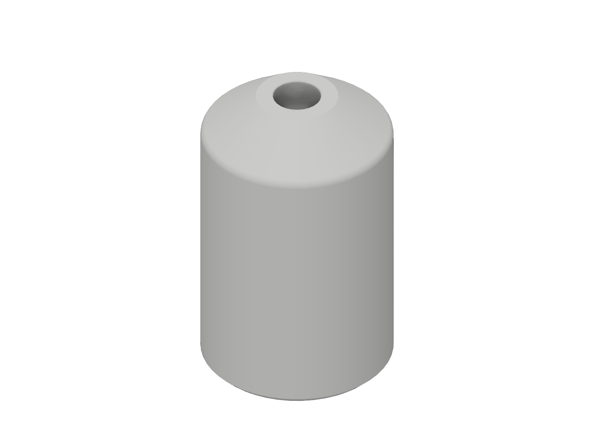
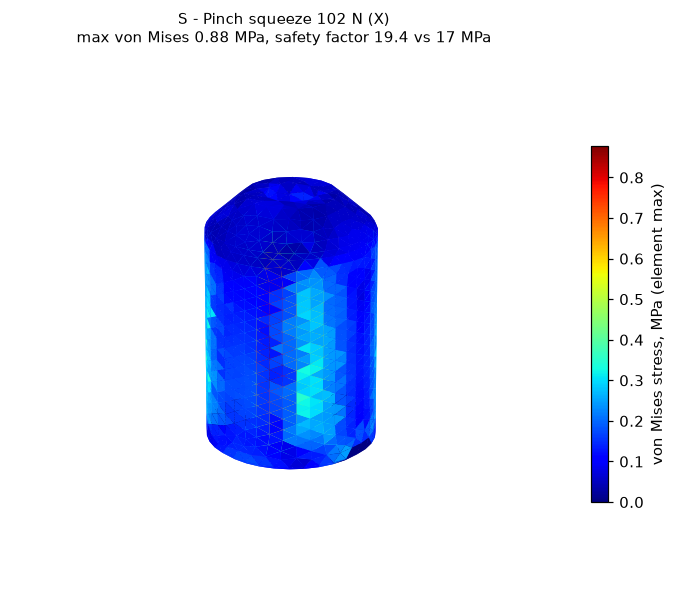

# Pen grip

> **untested, v0.1** - This design has not been printed or physically tested.
> It is **not a medical device**. See the
> [repository disclaimer](../../DISCLAIMER.md).

A thick sleeve that slides onto a pen or pencil, so it can be held with a looser, larger grip.

## Who it is for

People who find a standard pen too thin to hold: weak pinch, hand pain or tremor, or difficulty closing the fingers. The same users who are often given foam built-up tubing on their pens.

## Status

| Stage | State |
|-------|-------|
| Dimensions researched and cited | done (bore sizes are design estimates) |
| CAD built from named parameters | done (Fusion, 8 user parameters, all sketches fully constrained) |
| Model checked (dimensions, interference, min wall) | done |
| Static stress study run | done (open-source solver, see [Simulation](#simulation)) |
| STL and STEP exported | done (S, M, L) |
| Sliced and print stats recorded | done |

## Fit

The pen goes in through the wide end. Its tip comes out of the nose, and the barrel's own taper wedges it in the tapered bore (11 mm at the back to 7 mm at the nose). **The bore sizes are design estimates.** The only peer-reviewed pen dimension I found is the 8 mm equivalent-diameter pen that gave the best drawing accuracy in Goonetilleke et al. (2009). The bore brackets it. Measure your pen.

## Size presets

There is no peer-reviewed optimum diameter for a built-up pen grip for weak hands, so the presets follow products occupational therapists already use, plus the handle-sleeve rule:

| Preset | `grip_od` | Basis |
|--------|-----------|-------|
| Small  | 22 mm   | Outer diameter of the smaller closed-cell foam built-up tubing (1/4 in bore) |
| Medium | 28 mm   | Outer diameter of the larger foam tubing (3/8 in and 5/8 in bores) |
| Large  | 32.5 mm | 19.7 % of 5th-percentile female hand length (Kong & Lowe 2005, ANSUR II), the same as the Small handle sleeve; for users who hold a pen in a fist |

Length is 45 mm on every preset (design estimate: covers the finger contact zone).

## Print settings

Sliced with the **ElegooSlicer 1.5.2.2 command line** using its bundled Prusa MK3S profile. Times are the slicer's estimate.

| Setting | Value |
|---------|-------|
| Printer profile | Prusa MK3S, 0.4 mm nozzle |
| Material | PLA (Prusa Generic PLA, 1.24 g/cm3) |
| Layer height | 0.30 mm (first layer 0.20 mm) |
| Perimeters | 2 (0.50 mm extrusion width) |
| Infill | 10 %, crosshatch |
| Supports | none (the slicer generated no support material) |
| Orientation | upright, wide end down, nose up |

| Preset | Print time | Filament | Slicer |
|--------|-----------|----------|--------|
| Small  | 25 m | 7.5 g  | ElegooSlicer 1.5.2.2 CLI |
| Medium | 30 m | 9.8 g  | ElegooSlicer 1.5.2.2 CLI |
| Large  | 37 m | 12.3 g | ElegooSlicer 1.5.2.2 CLI |

## How to resize

Open the `.f3d` in `cad/` (or run `cad/build_pen_grip.py` in Fusion), then **Modify > Change Parameters**.

| Parameter | Default (M) | Controls |
|-----------|-------------|----------|
| `grip_od` | 28 mm | Outer diameter |
| `grip_len` | 45 mm | Length |
| `bore_wide` | 11 mm | Bore at the back end |
| `bore_narrow` | 7 mm | Bore at the nose, where the pen wedges |
| `nose_h` | 6 mm | Height of the nose cone |
| `nose_in` | `grip_od / 2 - bore_narrow / 2 - 2.5 mm` | Nose taper; keeps 2.5 mm of wall at the tip |
| `base_chamfer` | 1 mm | 45 degree bed-edge chamfer |
| `nose_r` | 1.5 mm | Blend between barrel and nose |

## How to use

1. Push the pen tip-first into the wide end until the tip pokes out of the nose and the barrel wedges.
2. If the pen is loose, wrap tape around the barrel, or reduce `bore_narrow` and reprint. If it will not reach the nose, increase `bore_narrow`.
3. Hold the grip wherever is comfortable. The nose cone lets the fingers sit close to the tip.

## Model checks (from the Fusion model)

| Check | Result |
|-------|--------|
| Timeline | 9 features, 0 errors |
| Sketches | 3 of 3 fully constrained |
| Bounding box (S / M / L) | 22 x 22 x 45 / 28 x 28 x 45 / 32.5 x 32.5 x 45 mm |
| Base | flat, 1 mm chamfer at 45 degrees |
| Overhangs | none: the outside only narrows going up (nose cone), and the bore only narrows going up |
| Interference | single body |
| Minimum wall (Fusion `measureMinimumDistance`) | 2.5 mm at the nose tip on all presets (5 extrusion lines) |

## Simulation

**Solver note:** Fusion's simulation scripting API returned no simulation product on this install, so the study was run with **gmsh 4.15.2 + scikit-fem 12.0.2** (quadratic tetrahedra, linear static, 2 mm mesh). **This is not a Fusion Simulation result.**

| Item | Value |
|------|-------|
| Material | PLA, E = 2.3 GPa (Prusament PLA datasheet), Poisson's ratio 0.36 (**assumed**) |
| Load | 102 N pinch from each side, on two opposite 90 degree patches of the barrel (z = 5 mm to 8 mm below the top) |
| Constraints | The squeeze balances itself; 3-2-1 point support at the base (reactions 0.0 N), stresses within 4 mm of those points excluded |
| Reasoning for the load | 102 N = 10.4 kg, the mean right-hand key pinch of healthy men (Gunther et al. 2008): a deliberately high estimate of the squeeze a writer can apply |
| Peak von Mises | 0.88 MPa (S), 0.58 MPa (M), 0.46 MPa (L) |
| **Minimum safety factor** | **19.4** (Small, von Mises against the 17 MPa interlayer adhesion, the strictest rule used in this library) |

Target met with a wide margin. The part is mostly limited by fit and comfort, not strength.

## Known limits

- **Never printed, never handled, never tested by a person.**
- The bore sizes are design estimates. Pens vary widely in diameter and taper; the fit is wedge-only.
- Hard PLA, not soft like foam tubing. It will not cushion the fingers.
- The stress model is a solid part; the print is 2 perimeters and 10 % infill.
- PLA softens near 55 C.

## Files

| File | Description |
|------|-------------|
| `cad/pen-grip_v0.1.f3d` | Fusion archive (parametric, M preset active) |
| `cad/build_pen_grip.py` | Fusion API script that rebuilds the model |
| `cad/model_measurements.json` | Volume, bounding box and parameters per preset, read from Fusion |
| `step/`, `stl/` | Per-preset STEP and STL |
| `renders/` | Fusion viewport captures |
| `simulation/` | Solver, study setup, results, stress plots |

## Sources

- Goonetilleke, R. S., Hoffmann, E. R. & Luximon, A. (2009). Effects of pen design on drawing and writing performance. *Applied Ergonomics* 40(2). https://doi.org/10.1016/j.apergo.2008.04.015
- Closed-cell foam built-up tubing (bore x outer diameter: 6 x 22 mm, 10 x 28 mm, 16 x 28 mm; sold for "cutlery, pens, toothbrush"): Essential Aids, https://essentialaids.com/children-with-disabilities/children-s-cutlery/closed-cell-foam-tubing.html
- Kong, Y.-K. & Lowe, B. D. (2005). Optimal cylindrical handle diameter for grip force tasks. *International Journal of Industrial Ergonomics* 35(6). https://stacks.cdc.gov/view/cdc/197408
- ANSUR II public data: https://www.openlab.psu.edu/ansur2/
- Gunther, C. M. et al. (2008). Key pinch in healthy adults: normative values. *Journal of Hand Surgery (European Volume)*. https://doi.org/10.1177/1753193408087031
- Prusament PLA technical datasheet v1.1: https://prusament.com/wp-content/uploads/2022/10/PLA_Prusament_TDS_2021_10_EN.pdf

## Version and changelog

| Version | Date | Change |
|---------|------|--------|
| v0.1 | 2026-11-10 | First build. Tapered bore, nose cone, S/M/L outer diameters. Static stress: minimum SF 19.4, no revision needed. |
